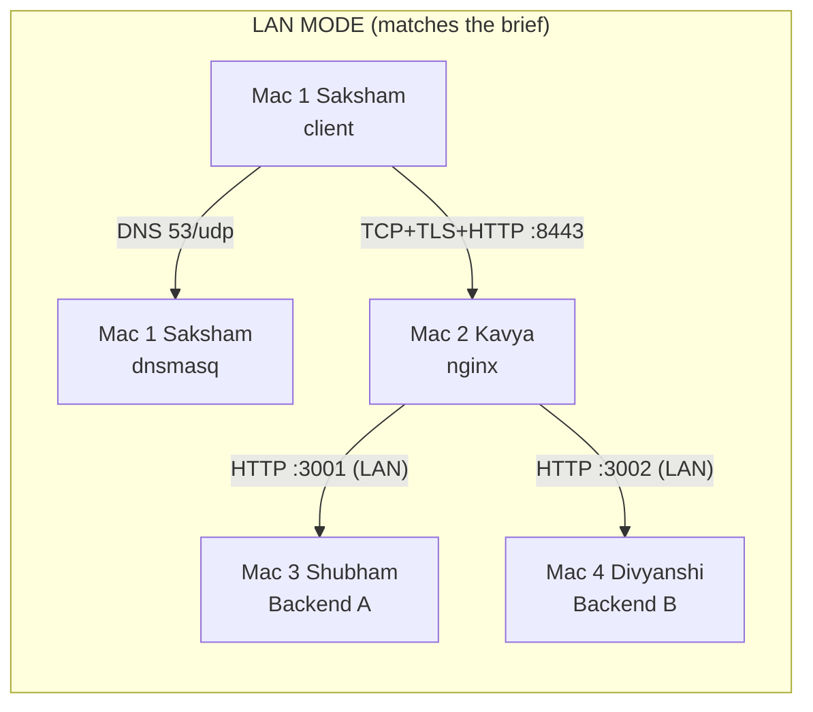
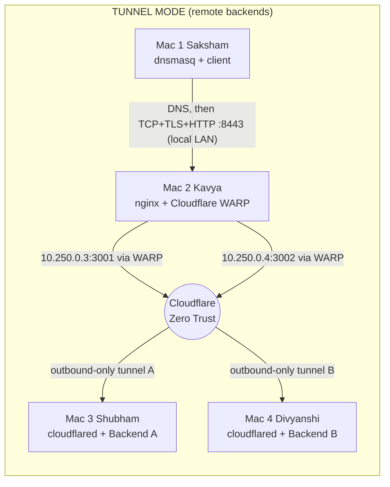

# CN Private Network Service Platform - Phase 1 + Phase 2

**What this does.** A client types `https://app.teamX.test:8443`. Our own DNS server (dnsmasq) turns that
name into the edge Mac's IP, the client opens a TCP connection and a TLS session to nginx, and nginx
forwards the HTTP request - alternating - to Backend A or Backend B. Every step can be observed with
`dig`, `curl -v`, and Wireshark. *The application stays simple; the network is the project.*

| Mac | Person | LAN IP | Role | Ports |
|---|---|---:|---|---|
| 1 | **Saksham Miglani** | `10.3.3.96` | Primary DNS, controller, test client | 53/udp+tcp |
| 2 | **Kavya Mukhija** | `10.3.3.178` | Primary nginx edge and backup DNS | 8443/tcp, 53/udp+tcp |
| 3 | **Shubham Jain** | `10.3.3.71` | Python Backend A | 3001/tcp |
| 4 | **Divyanshi Khanka** | `10.3.3.104` | Python Backend B and standby nginx edge | 3002/tcp, 8443/tcp |

LAN: `10.3.0.0/22`; gateway: `10.3.0.1`; names: `app.teamX.test` and
`api.teamX.test`. These recorded DHCP addresses must be rechecked before a live run.

## Two network modes (`NETWORK_MODE`)

* **`lan`** - the architecture from the university brief. All four Macs share one private Wi-Fi/LAN and talk directly. **This is the mode to submit and demo unless faculty approves otherwise.**
* **`tunnel`** - for when Shubham/Divyanshi are physically remote. Only the *nginx -> backend* hop changes: it travels over a Cloudflare Zero Trust private network. Saksham <-> Kavya (DNS, TCP, TLS, HTTP) stay on the local LAN, so those layers remain observable.

> Tunnel mode is **not** equivalent to a four-Mac LAN (the brief requires a shared LAN, LAN inventory and pairwise pings, and a locally-run system). It exists for remote development/demo. Nothing in the application, nginx or DNS code changes between modes - only the upstream addresses.





More diagrams: [docs/diagrams.md](docs/diagrams.md). Request walk-through: [docs/REQUEST_FLOW.md](docs/REQUEST_FLOW.md).

## Quick start - one command per Mac

Everyone: `git clone <repo> && cd <repo>`. Run **in this order** (Kavya creates the CA others need):

| Order | Who | Command |
|---|---|---|
| 1 | Shubham | `./macs/mac3-shubham/setup.sh` |
| 1 | Divyanshi | `./macs/mac4-divyanshi/setup.sh` |
| 2 | Kavya | `./macs/mac2-kavya/setup.sh` then `git add pki/ca.crt && git commit && git push` |
| 3 | Saksham | `git pull && ./macs/mac1-saksham/setup.sh` |
| 4 | any other client | `git pull && scripts/configure-client-dns.sh` |

Setup scripts ask once for non-secret values (team name, mode, LAN IPs) and remember them in
`~/.config/cn-phase1/project.env` (chmod 600). They are **idempotent** - run them again any time.
Tunnel mode additionally needs the one-time admin step: [docs/CLOUDFLARE_MODE.md](docs/CLOUDFLARE_MODE.md).

## Phase 2 (Harden, Recover, Troubleshoot) - same idea, one command per Mac

`./bin/phase2 setup` on every Mac (it works out that Mac's duty from its IP; the Phase 1 setup scripts call it too). Then:
`bin/phase2 test` (checks A-E) and one command per demo: `dns-failover` (A), `ttl` (B), `isolate on|off|test` (C), `failover` (D), `cutover` (E), `bin/doctor` + `drill` (F).
Order, reasoning and limits: [docs/PHASE2.md](docs/PHASE2.md). Transcripts of every demo land in `evidence/phase2/`.

## Daily commands (any Mac, after setup)

```bash
./bin/start | stop | status      # this Mac's role + whole-system view (real requests, not pgrep)
./bin/test-all                   # layered PASS/FAIL, non-zero exit on failure
./bin/doctor                     # first failing layer + concept + commands to investigate
./bin/collect-evidence           # timestamped evidence/<time>/ (no secrets)
./bin/failure-demo <scenario> <break|rollback|explain>
./bin/teardown                   # stop services, remove scoped resolver
./bin/phase2 help                # Phase 2: setup | status | test | demos | rollback
scripts/capture-packets.sh 60    # bounded tcpdump for Wireshark (Task G)
```

## Repo map

```
backends/server.py      one stdlib-only REST backend (A or B by env)
config/                 project.example.env (all constants), dnsmasq + nginx templates
scripts/                common.sh, roles.sh, role.sh, checks.sh, phase2.sh, CA/DNS/capture helpers
macs/mac{1..4}-*/       setup|start|stop|status.sh + README per machine
bin/                    operator commands       tests/   per-layer tests
admin/                  one-time Cloudflare bootstrap (Saksham only)
docs/                   architecture, flow, viva, failures, troubleshooting
pki/ca.crt              PUBLIC CA certificate (safe to commit)
evidence/               original Phase 1 archive + newly collected team outputs
```

## Where things live (never in git)

`~/.config/cn-phase1/` - saved settings, generated configs, `tls/` (CA + server private keys), `secrets/` (tunnel credentials), backups.
`~/Library/Logs/cn-phase1/` - dnsmasq, nginx access/error, backend, cloudflared logs.

## Security rules

Never commit tokens, credentials JSON, `.env`, or any private key (`.gitignore` blocks them). The CA *private* key never leaves the edge Mac; clients receive only `pki/ca.crt`. Scripts back up any file before touching it (`~/.config/cn-phase1/backups/INDEX`) and never use `curl -k`.

## Docs

[ARCHITECTURE](docs/ARCHITECTURE.md) - [REQUEST_FLOW](docs/REQUEST_FLOW.md) - [PHASE1](docs/PHASE1.md) (task-by-task checklist) - [PHASE2](docs/PHASE2.md) (extensions A-F) - [LAN_MODE](docs/LAN_MODE.md) - [CLOUDFLARE_MODE](docs/CLOUDFLARE_MODE.md) - [FAILURE_DEMOS](docs/FAILURE_DEMOS.md) - [TROUBLESHOOTING](docs/TROUBLESHOOTING.md) - [VIVA](docs/VIVA.md)

Migration records: [ATTRIBUTION](ATTRIBUTION.md) - [SOURCE_PARITY](docs/SOURCE_PARITY.md) - [VALIDATION](docs/VALIDATION.md). The implementation is adapted with permission from the credited reference repository; no reference private keys, credentials, or evidence were imported.
